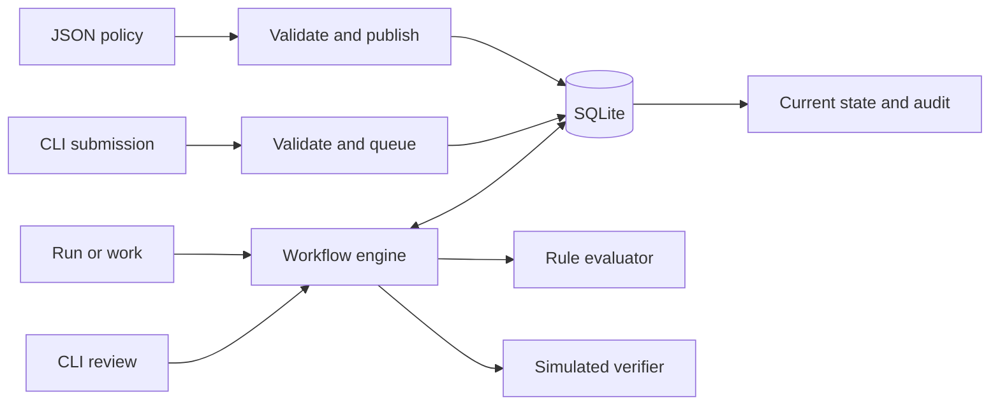

# Architecture

The platform separates policy definition, rule evaluation, orchestration, and persistence. Department requirements and routing live in versioned JSON. The Python engine implements stage execution. The onboarding policy defines the evidence, department rules, and routes that determine whether a hire is ready.

| Component | Responsibility |
|---|---|
| `decision/__main__.py` | Command parsing, JSON input and output, error mapping. |
| `decision/policy.py` | Validate policy shape, types, and graph; validate request data; evaluate pure rules. |
| `decision/engine.py` | Manage request identity, version selection, transitions, dependency attempts, retries, and review. |
| `decision/store.py` | Database schema, foreign keys, transactions, and indexes. |

## Data flow and invariants

1. **Publish.** Validate a proposed graph before writing. Store the full definition under `(name, version)` and atomically move the active pointer. A version is immutable through the engine; it can be reactivated.
2. **Submit.** Look up `(workflow, idempotency key)` before validating against the active policy. The same canonical payload returns the original request, even after a policy change. Different content with the same key is a conflict. New requests store a UUID, immutable input snapshot, pinned version, and starting stage; the submission event commits with the request.
3. **Execute.** Process one stage per transaction. Each transition commits the new state and an audit event together. Normal branches advance the graph; a temporary dependency error waits and retries at the same stage. Terminal or review requests are skipped by workers. An interruption between stages leaves a runnable request at its last committed stage.
4. **Explain.** Read the request and its events from the same database snapshot. Events record source and destination states, the stage ID, input field references, comparison criteria and result, dependency attempts, and human decisions. Resolve field references against the stored input snapshot and stage IDs against the pinned policy. Event sequence numbers order transitions even when timestamps tie.

## Failure behavior

| Scenario | Behavior |
|---|---|
| Duplicate intake or lost submit response | The unique key and write transaction converge on one request and one intake event. JSON object key ordering is ignored; numeric spellings such as `1` and `1.0` are distinct. |
| Temporary dependency outage | Persist the attempt and retry time; the delay doubles after each failure up to one hour. A due request can resume after process restart. The configured attempt cap routes to manual review. |
| Definitive verification failure | Follow the policy's failure branch immediately. |
| Audit write fails after state update | Roll back the stage transaction. A subsequent run reads the prior stage and can retry it. |
| Multiple workers select the same request | Each stage checks current state inside a SQLite write transaction. A worker seeing a future retry, terminal result, or review pause skips it. |
| Repeated review | Once decided, a second review fails with a conflict, and the original decision remains visible. |

Unexpected adapter exceptions roll back the stage and surface as errors; they are not classified as recoverable outages. Dependency attempts are counted when their audit and state commit. A crash after an adapter call but before commit can replay that call with the same stage operation ID. The demo verifier is local and read-only, so replay is safe.

## Trade-offs and scaling

SQLite and a CLI make the submission portable and let us demonstrate atomic changes without extra services. SQLite in WAL mode allows concurrent reads and serializes writes. The simulator runs inside the write transaction because it returns immediately and has no side effects. This makes local stage ownership straightforward but would block writers if used with a slow network dependency.

For a networked deployment, use a transactional job or outbox record, then let workers claim work with leases and call the dependency outside the database transaction. Use the stable stage operation ID for provider deduplication when there are side effects; persist the result and transition with a conditional version or lease check. Add request timeouts, bounded concurrency, jitter, and retry monitoring. For several hosts, move state to a server database, index the due queue, and use row-level claims. Page audit reads and define a retention policy before audit history grows large.

The CLI assumes a trusted local operator. Reviewer names are recorded assertions, and audit rows are append-only through the application; direct database access can modify them. A shared service would need authenticated reviewers, access controls for stored inputs, restricted policy publishing, and independent audit retention. Workflows are acyclic by design so each run is bounded; retries are the only loop. Missing evidence routes according to policy instead of being silently inferred.
